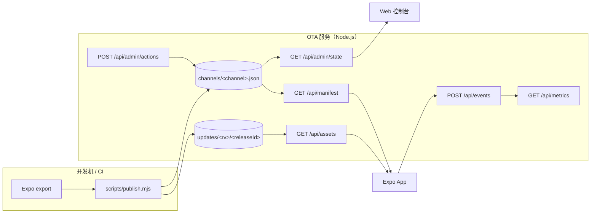

# React Native Expo OTA Server

React Native Expo OTA Server is a self-hosted update server for iOS and Android apps built with React Native and Expo. It implements the Expo Updates v1 protocol with signed manifests, release channels, staged and per-platform rollouts, whitelists, instant rollback, audit logs, and a web console. Powered only by Node.js built-ins.

一个面向 iOS 和 Android 的 React Native 自托管 OTA 更新平台，不依赖 EAS 云服务，实现 [Expo Updates v1](https://docs.expo.dev/technical-specs/expo-updates-1/) 的核心协议：

- `runtimeVersion` 与代码签名校验
- 通道、灰度百分比、白名单和平台级灰度
- current / previous 版本指针、提升、回滚和重新发布
- 发布锁、幂等请求、审计日志
- 客户端事件采集与内置管理控制台
- 服务端零第三方运行时依赖，只需 Node.js 内置模块

仓库同时包含一个 Expo Demo App，用于展示检查、下载、应用更新以及切换测试通道的完整流程。

> 这是可运行的自托管实现，不是 EAS 的完整替代品。用于生产前请阅读[已知限制](#已知限制)和[安全说明](#安全说明)。

## 功能

| 能力 | 说明 |
|---|---|
| 更新协议 | 支持 Expo Updates v1 manifest、assets、gzip 和 `rollBackToEmbedded` |
| 通道 | 请求头 `expo-channel-name` 决定更新流，通道按需创建 |
| 灰度 | SHA-256(uid) 稳定分桶，支持百分比、白名单和 iOS / Android 独立阈值 |
| 版本管理 | current / previous、发布、提升、回滚、重新发布 |
| 完整性 | manifest RSA-SHA256 签名，客户端内置公钥证书强校验 |
| 可观测性 | 请求与客户端事件落盘，提供指标 API 和 Web 控制台 |
| 运维安全 | 管理令牌、通道锁、请求幂等、审计日志、事件限流 |
| 客户端 | Expo Demo，包含更新状态机、错误边界、日志脱敏和调试面板 |

## 架构



发布流程会生成不可变 release 目录、预计算资产索引与 gzip 副本，然后以原子写入更新通道指针。

## 技术栈

| 组件 | 版本 / 要求 |
|---|---|
| Expo SDK | 58 |
| React Native | 0.88 |
| React | 19 |
| OTA 服务 | Node.js >= 20，仅使用内置模块 |
| 测试 | `node:test`，无测试框架依赖 |
| iOS 构建 | Xcode + Apple Development 签名 |
| Android 构建 | JDK 21+、Android SDK 37、NDK 27 |

## 目录结构

```text
.
├── apps/mobile/
│   ├── App.js                     # Demo OTA 控制台
│   ├── app.config.js              # 通道、OTA URL、签名与构建 profile
│   ├── certs/certificate.pem      # 客户端验签公钥证书（公开）
│   ├── src/
│   │   ├── update.js              # 检查 / 下载 / 应用 / 通道覆盖
│   │   ├── api.js                 # 超时、重试与 ApiError
│   │   ├── logger.js              # 日志、脱敏与错误上报
│   │   ├── runtime-info.js        # 运行环境与设备 uid
│   │   ├── perf.js                # 首屏耗时
│   │   └── components/            # App UI
│   └── plugins/
│       └── withUpdatesChannel.js  # 把通道写入 iOS / Android 原生配置
├── services/ota/
│   ├── src/
│   │   ├── server.mjs             # HTTP 路由
│   │   ├── config.mjs             # 环境变量与 production 自检
│   │   ├── manifest.mjs           # manifest、签名与 rollback
│   │   ├── assets.mjs             # 资产分发与 gzip
│   │   ├── release-store.mjs      # 通道状态、发布锁与审计
│   │   ├── rollout.mjs            # uid 分桶与灰度决策
│   │   ├── metrics.mjs            # 事件落盘与聚合
│   │   ├── admin.mjs              # 管理写操作
│   │   └── dashboard*             # Web 控制台
│   ├── keys/                      # 私钥（不入库）
│   └── updates/                   # OTA 数据（不入库）
├── scripts/
│   ├── publish.mjs                # 发布、提升、重新发布
│   ├── rollout.mjs                # 灰度与白名单
│   ├── rollback.mjs               # 回滚
│   ├── preflight.mjs              # 发布后自检
│   ├── verify-manifest.mjs        # 协议 / 签名 / 分桶自检
│   ├── keygen.mjs                 # 生成签名密钥与证书
│   ├── dev-ios.mjs                # iOS 真机研发包
│   └── dev-android.mjs            # Android 模拟器 / 真机研发包
└── tests/                         # Node.js 回归测试
```

`apps/mobile/ios/` 和 `apps/mobile/android/` 是可重建的 Expo prebuild 产物，默认不提交。

## 快速开始

### 1. 安装依赖

根目录没有运行时依赖，移动端依赖单独安装：

```bash
cd apps/mobile
npm ci
cd ../..
```

### 2. 生成签名密钥

```bash
npm run ota:keygen
```

生成：

- `services/ota/keys/private-key.pem`：服务端私钥，**绝对不要提交**
- `apps/mobile/certs/certificate.pem`：客户端验签公钥证书，需要入库并随 App 分发

重新生成证书后，旧 App 将无法验签，必须重新打原生包。

### 3. 启动 OTA 服务

```bash
OTA_ADMIN_TOKEN='<random-admin-token>' \
OTA_PRIVATE_KEY_PATH="$PWD/services/ota/keys/private-key.pem" \
OTA_PUBLIC_BASE_URL='http://localhost:3000' \
npm run ota:start
```

打开 `http://localhost:3000/dashboard`。健康检查：

```bash
curl http://localhost:3000/healthz
```

本地模拟器可以直接使用 `localhost`；Android USB 真机可使用 `adb reverse`；iOS 真机和 Wi-Fi 设备必须使用手机可访问的局域网 IP 或 HTTPS 域名。

### 4. 导出并发布

开发环境可直接导出，再发布到通道：

```bash
npm run mobile:export
npm run ota:publish -- --from-dir apps/mobile/dist --channel development
```

实际迭代推荐使用 `ota:hotfix`，它会自动注入通道与 OTA URL、清理 Metro 缓存、导出并发布：

```bash
npm run ota:hotfix -- --channel development --rollout 100
```

发布成功后会默认执行一次 preflight，自检失败可中止发布：

```bash
npm run ota:publish -- \
  --from-dir apps/mobile/dist \
  --channel beta \
  --rollout 10 \
  --auto-rollback-on-fail
```

### 5. 自检与测试

```bash
npm run ota:verify -- \
  --channel development \
  --runtime-version 1 \
  --uid test-device-001 \
  --cert apps/mobile/certs/certificate.pem

npm test
```

## 本地开发与真机

### 启动 Demo

```bash
npm run mobile:start
```

普通 `expo start` 不执行 OTA。验证更新能力必须安装 Release 研发包。

### iOS 真机

`app.config.js` 不内置 Apple Team ID，真机签名必须显式设置：

```bash
EXPO_APPLE_TEAM_ID=<your-team-id> \
npm run mobile:ios:dev -- --device "<device-name>"
```

可选参数：

```bash
npm run mobile:ios:dev -- --device "<device-name>" --channel canary
npm run mobile:ios:dev -- --device "<device-name>" --url http://<lan-ip>:3000/api/manifest
npm run mobile:ios:dev -- --device "<device-name>" --skip-build
```

脚本会：

1. 探测局域网 IP，并把 `EXPO_PUBLIC_OTA_URL` 写进原生 `updates.url`；
2. 校验 `EXUpdatesChannel`、`expo-channel-name` 请求头与更新地址一致；
3. 执行 prebuild、Release 构建并安装到设备。

如果 iOS 提示未信任开发者，在系统设置中信任对应开发者证书后重新启动 App。

### Android 模拟器 / 真机

```bash
# 自动选择在线设备或启动第一个 AVD
npm run mobile:android:dev

# 指定 USB 真机、AVD 或通道
npm run mobile:android:dev -- --device <serial>
npm run mobile:android:dev -- --avd <avd-name> --channel canary

# Wi-Fi 真机或完全覆盖 OTA 地址
npm run mobile:android:dev -- --lan
npm run mobile:android:dev -- --url http://<host>:3000/api/manifest
```

Android 默认使用 `localhost` + `adb reverse tcp:3000`。Wi-Fi 真机使用 `--lan` 或 `--url`。HyperOS / MIUI 需要开启“开发者选项 → USB 安装”。

### 验证 OTA 生效

典型行为是首次冷启动下载，第二次冷启动应用：

```bash
# Android 状态与验签日志
adb logcat -s dev.expo.updates:V | grep -E 'CheckComplete|Download|signature'

# 连续冷启动两次
adb shell am force-stop com.example.hotupdatedemo
adb shell monkey -p com.example.hotupdatedemo -c android.intent.category.LAUNCHER 1
```

服务端收到 `client-launch` 且 `embedded: false`，或 App 调试面板显示“OTA 更新”，即可确认当前运行的是 OTA 版本。

## 通道与灰度

推荐使用四条通道，但通道本身是按需创建的：

| 通道 | 用途 | 建议灰度 |
|---|---|---|
| `development` | 本地研发、CI | 100% |
| `canary` | 内部 QA、首发冒烟 | 1–5% |
| `beta` | 外部测试用户 | 5–20% |
| `production` | 正式用户 | 10% → 50% → 100% |

### 分流规则

- `sha256(uid)` 前 4 字节对 100 取模，同一设备始终落在同一 bucket；
- `bucket < percentage` 命中 current，否则命中 previous；
- 白名单直接命中 current；
- 请求没有 uid 时，只有 100% 才会命中 current；
- **通道没有 previous 时，灰度不会真正生效**，未命中的设备仍只能拿到 current；
- 平台覆盖只影响百分比，current / previous 仍由 iOS 和 Android 共用。

首次发布时如果尚未产生 previous，百分比看起来不会生效。要验证真实灰度，请先在同一通道发布第二个版本。

### 平台级灰度

```bash
# 只调整 Android；iOS 保持原值
npm run ota:rollout -- --channel beta --platform android --percentage 0

# 查看统一兜底值和平台覆盖
npm run ota:rollout -- --channel beta --show

# 清除平台覆盖
npm run ota:rollout -- --channel beta --clear-platform
```

生效优先级：

```text
expo-platform 请求头
  → rollout.byPlatform[platform]
  → rollout.percentage
```

### 白名单

```bash
npm run ota:rollout -- --channel beta --whitelist-add uid-a,uid-b
npm run ota:rollout -- --channel beta --whitelist-remove uid-a
npm run ota:rollout -- --channel beta --whitelist uid-a,uid-b
```

## 发布、提升与回滚

```bash
# 发布新版本；原 current 自动成为 previous
npm run ota:publish -- --from-dir apps/mobile/dist --channel beta --rollout 10

# 提升指定历史版本
npm run ota:publish -- --release <releaseId> --channel beta

# 重新发布当前版本并刷新时间戳
npm run ota:publish -- --touch --channel beta

# 回滚到 previous
npm run ota:rollback -- --channel beta

# 查看通道与历史版本
npm run ota:publish -- --list
```

`releaseId` 是毫秒时间戳，发布目录不可变。`expo-updates` 只接受 `createdAt` 更新的 manifest，因此提升和回滚会创建新 release 目录并刷新时间戳。

## 管理控制台

地址：`http://localhost:3000/dashboard`

- **概览**：统计卡、7 天请求趋势、通道状态和最近事件。
- **通道**：4 个通道以 Tab 切换，按 `development → canary → beta → production` 排序；每个面板包含版本状态、平台灰度、白名单、发布操作和可展开的最近变更。
- **版本**：发布产物列表、平台筛选、分页以及 current / previous 标记。
- **指标**：状态码、平台对比、通道明细和 updateId 命中。
- **事件**：服务端筛选、分页和原始事件查看。

写操作需要管理令牌，令牌只保存在浏览器 `localStorage`。以下操作均可回滚或重新配置：

- 同时保存 iOS / Android 灰度
- 维护全局白名单
- 回滚上一版本
- 重新发布当前版本
- 提升任意历史版本

服务端写接口使用通道锁和 `requestId` 幂等保护；审计记录写入通道 `history` 和 `audit.jsonl`。

## 环境变量

`.env.example` 是变量清单示例。本项目**不会自动加载 `.env`**，请通过 shell、CI 或进程管理器注入。

### 服务端

| 变量 | 说明 |
|---|---|
| `PORT` | HTTP 端口，默认 `3000` |
| `OTA_ENV` | `development` 或 `production`；production 启动时执行安全自检 |
| `OTA_PUBLIC_BASE_URL` | manifest 中资产 URL 的公开前缀 |
| `OTA_DATA_DIR` | OTA 数据目录，默认 `services/ota/updates` |
| `OTA_PRIVATE_KEY_PATH` | manifest 签名私钥，客户端要求签名时必填 |
| `OTA_KEY_ID` | 签名 key id，默认 `main` |
| `OTA_ADMIN_TOKEN` | 控制台和管理 API 令牌 |
| `OTA_ADMIN_TOKENS` | 多令牌格式：`alice:token-a,bob:token-b` |
| `OTA_OPERATOR` | CLI 操作人标签 |
| `OTA_EVENTS_RATE_LIMIT` | 每 IP 每分钟事件上报上限，默认 `60`，设为 `0` 关闭 |
| `OTA_TLS_KEY` / `OTA_TLS_CERT` | 可选，直接由 Node 提供 HTTPS |
| `OTA_HEALTH_URL` | 发布自检访问的健康检查地址 |

### 客户端构建

| 变量 | 说明 |
|---|---|
| `EXPO_PUBLIC_APP_ENV` | `development` / `staging` / `production` profile |
| `EXPO_PUBLIC_CHANNEL` | 构建时写入原生的通道 |
| `EXPO_PUBLIC_OTA_URL` | 构建时写入原生的 manifest 地址 |
| `EXPO_PUBLIC_ENABLE_CHANNEL_SWITCH` | 是否启用内部运行时通道切换，生产必须关闭 |
| `EXPO_APPLE_TEAM_ID` | iOS 真机签名 Team ID |

`EXPO_PUBLIC_OTA_URL` 必须与打包时使用同一个 origin，因为它决定 `expo-updates` 的 scope；切换 origin 会导致 uid 和已下载包失效。

## API

| 方法与路径 | 说明 |
|---|---|
| `GET /api/manifest` | 根据通道、平台、runtimeVersion 和 uid 返回 manifest |
| `GET /api/assets` | 下载资产，支持 gzip 与 immutable 缓存 |
| `GET /api/channels` | 通道版本与灰度状态 |
| `GET /api/metrics` | 7 天指标聚合与平台分组 |
| `POST /api/events` | 客户端事件上报 |
| `GET /api/audit` | 审计日志 |
| `GET /api/admin/state` | 控制台聚合数据 |
| `POST /api/admin/actions` | 管理写操作，需要令牌 |
| `GET /healthz` | 健康检查 |
| `GET /dashboard` | 管理控制台 |

manifest 的 `metadata` 会返回 `channel`、`releaseId`、`rollout`、`served` 和 `bucket`，便于客户端和服务端排查灰度结果。

## 代码签名

- 使用 RSA-SHA256 对 manifest JSON 字节签名；
- 客户端通过 `updates.codeSigningCertificate` 内置公钥证书；
- 证书必须包含 Code Signing EKU，`keyid` 必须与服务端一致；
- 私钥只存在服务端或 CI，不进入仓库；
- 服务端进程内缓存私钥，读取失败时下次请求重试。

当前实现由服务端持有私钥。安全要求更高时，应改为在 CI 中签名后上传，服务端只负责分发。

## 测试

```bash
npm test
```

测试使用 Node.js 内置 `node:test`，覆盖：

- 分桶、白名单、无 uid 和无 previous 行为
- 路径安全、哈希、SFV 解析和 Content-Type
- manifest 签名与篡改检测
- 发布锁、超时、异常释放和幂等缓存
- 指标聚合、事件筛选和轮转文件
- 控制台渲染、通道 Tab、自动刷新和参数隔离

## 部署建议

1. 使用 HTTPS 反向代理，并保留 `x-forwarded-for`。
2. 将 `services/ota/updates` 放到持久化卷，定期备份。
3. 私钥通过 secret manager 注入，不要写入镜像或仓库。
4. 设置强随机 `OTA_ADMIN_TOKEN`，生产环境启用 `OTA_ENV=production`。
5. 只运行一个写入实例；当前通道锁和 JSON 数据存储不做多副本协调。
6. 在 App Store / Google Play 发布前替换示例 Bundle ID、包名和签名证书。

## 安全说明

- manifest 和 assets 默认公开可拉取；签名用于完整性校验，不提供访问控制。
- `/api/events` 是公网写入口，已实现限流和 16 KB 请求体限制，但生产环境仍建议在反向代理层增加额外限制。
- 管理令牌只存在浏览器本地，换浏览器需要重新输入。
- 生产构建必须关闭 `EXPO_PUBLIC_ENABLE_CHANNEL_SWITCH`，避免关闭防砖保护。
- 不要提交 `.env`、私钥、Provisioning Profile、Keystore 或真实用户 uid。
- `apps/mobile/certs/certificate.pem` 是公开验签证书，可以提交；对应私钥必须保密。

## 已知限制

- 没有 previous 的首次发布无法产生真实灰度回退。
- 当前是单机、单进程架构；JSON 状态和文件锁不支持多实例并发写。
- 不支持增量差分更新，只提供完整 bundle 与 gzip。
- 资产下载不支持 Range / 断点续传。
- 旧 release 不会自动 GC，提升和重新发布会复制目录。
- 没有自动异常止损，也不会根据客户端 emergency 上报自动回滚。
- 平台灰度只拆分百分比，不能让 iOS / Android 指向不同 release。
- 运行时通道切换只用于内部调试，不应出现在生产包。
- 未包含原生崩溃采集、符号化、CI/CD 或容器编排配置。

## 故障排查

| 现象 | 排查方向 |
|---|---|
| 发布成功但客户端收不到更新 | 检查 `runtimeVersion`、channel、`createdAt` 是否更新、客户端是否带正确通道请求头 |
| 灰度比例不生效 | 通道是否已有 previous；请求是否携带 uid；平台覆盖是否覆盖了统一值 |
| iOS 拒绝更新 | 检查证书 EKU、keyid、私钥与公钥是否匹配 |
| Android 拒绝更新 | 检查 manifest 签名、明文 HTTP 配置和 `adb reverse` |
| App 仍运行旧代码 | OTA 通常在下一次冷启动生效；连续冷启动两次验证 |
| Android 安装失败 `INSTALL_FAILED_USER_RESTRICTED` | 在系统开发者选项中允许 USB 安装 |
| iOS 提示未信任开发者 | 在系统设置中信任开发者证书后重新启动 App |
| 控制台写操作返回 403 | 服务端未配置管理令牌，或浏览器令牌无效 |
| 发布提示锁被占用 | 检查残留 `.lock` 和正在运行的发布进程 |
| 删除数据后通道消失 | 通道是懒创建的，重新发布即可恢复 |

## 说明

这是一个独立的 Expo OTA 实现示例，与 Expo / EAS 官方无隶属关系。协议细节以官方 Expo Updates 规范为准。
