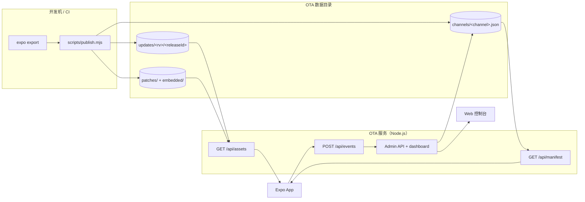

# React Native Expo OTA Server

Self-hosted [Expo Updates v1](https://docs.expo.dev/technical-specs/expo-updates-1/) server for React Native / Expo apps on iOS and Android — 无需 EAS 云服务，服务端零第三方运行时依赖。

本项目实现签名 manifest、通道与灰度、增量差分、断点续传、即时回滚、审计日志和 Web 控制台，并附带一个 Expo Demo App，用于演示检查、下载、应用更新以及切换测试通道的完整流程。

> 这是可运行的自托管实现，不是 EAS 的完整替代品。用于生产前请先阅读 [生产部署](#生产部署) 与 [已知限制](#已知限制)。

## 目录

- [功能特性](#功能特性)
- [架构与技术栈](#架构与技术栈)
- [快速开始](#快速开始)
- [使用指南](#使用指南)
  - [命令速查](#命令速查)
  - [项目结构](#项目结构)
  - [通道与灰度](#通道与灰度)
  - [发布与回滚](#发布与回滚)
  - [管理控制台](#管理控制台)
  - [本地开发与真机](#本地开发与真机)
- [实现细节](#实现细节)
  - [增量差分更新](#增量差分更新)
  - [资产断点续传](#资产断点续传)
  - [代码签名](#代码签名)
- [参考](#参考)
  - [API](#api)
  - [环境变量](#环境变量)
  - [测试](#测试)
- [生产部署](#生产部署)
- [故障排查](#故障排查)
- [说明](#说明)

## 功能特性

| 能力 | 说明 |
|---|---|
| 更新协议 | Expo Updates v1 manifest、assets、gzip 和 `rollBackToEmbedded`，按 `runtimeVersion` 隔离 |
| 增量差分 | 标准 `BSDIFF40` 补丁，A-IM 协商 + `226 IM Used`，支持历史版本与内置包 base，失败自动回退完整包 |
| 断点续传 | 资产支持单区间 `Range`、`206` / `416`、`If-Range` 与 HEAD 探测，分片流式下发 |
| 通道 | 请求头 `expo-channel-name` 决定更新流，通道按需创建 |
| 灰度 | `sha256(uid)` 稳定分桶，支持百分比、白名单和 iOS / Android 独立阈值 |
| 版本管理 | current / previous 指针、发布、提升、回滚、重新发布 |
| 完整性 | manifest RSA-SHA256 签名，客户端内置公钥证书强校验 |
| 可观测性 | 请求与客户端事件落盘，提供指标 API 和 Web 控制台 |
| 运维安全 | 管理令牌、通道锁、请求幂等、审计日志、事件限流 |
| 客户端 Demo | 更新状态机、错误边界、日志脱敏、调试面板，以及 OTA 服务地址与端口显示 |

## 架构与技术栈



- **发布**：生成不可变 release 目录（资产索引、gzip 副本、可选补丁），再以原子写入更新通道指针 current / previous。
- **下发**：客户端带 `expo-channel-name`、runtimeVersion 和 uid 请求 manifest；服务端按通道状态、灰度分桶和平台覆盖决策，返回签名后的 manifest；assets 按请求协商返回完整包、gzip、差分补丁或字节区间。
- **观测与运维**：客户端事件落盘聚合为指标；控制台通过带令牌的 Admin API 读写通道状态，写操作受通道锁、`requestId` 幂等和审计记录保护。

| 组件 | 版本 / 要求 |
|---|---|
| Expo SDK | 58 |
| React Native | 0.88 |
| React | 19 |
| OTA 服务 | Node.js >= 20，仅使用内置模块 |
| 测试 | `node:test`，无测试框架依赖 |
| iOS 构建 | Xcode + Apple Development 签名 |
| Android 构建 | JDK 21+、Android SDK 37、NDK 27 |

## 快速开始

前置条件：Node.js >= 20；移动端依赖单独安装。差分补丁为可选能力，需要发布机安装官方 `bsdiff` 4.3（见[增量差分更新](#增量差分更新)）。

### 1. 安装依赖

```bash
cd apps/mobile && npm ci && cd ../..
```

根目录没有运行时依赖。

### 2. 生成签名密钥

```bash
npm run ota:keygen
```

生成 `services/ota/keys/private-key.pem`（服务端私钥，**绝对不要提交**）和 `apps/mobile/certs/certificate.pem`（客户端验签公钥证书，公开且需随 App 分发）。重新生成证书后旧 App 无法验签，必须重新打原生包。

### 3. 启动 OTA 服务

```bash
OTA_ADMIN_TOKEN='<random-admin-token>' \
OTA_PRIVATE_KEY_PATH="$PWD/services/ota/keys/private-key.pem" \
OTA_PUBLIC_BASE_URL='http://localhost:3000' \
npm run ota:start
```

打开 `http://localhost:3000/dashboard`，健康检查：`curl http://localhost:3000/healthz`。

本地模拟器可直接用 `localhost`；Android USB 真机可用 `adb reverse`；iOS 真机和 Wi-Fi 设备必须使用手机可访问的局域网 IP 或 HTTPS 域名。

### 4. 导出并发布

```bash
npm run mobile:export
npm run ota:publish -- --from-dir apps/mobile/dist --channel development
```

实际迭代推荐 `ota:hotfix`：自动注入通道与 OTA 地址、清理 Metro 缓存、导出并发布。

```bash
npm run ota:hotfix -- --channel development --rollout 100
```

发布后默认执行一次 preflight 自检，可选 `--auto-rollback-on-fail` 在自检失败时自动回滚（详见[发布与回滚](#发布与回滚)）。

### 5. 验证

```bash
npm run ota:verify -- \
  --channel development \
  --runtime-version 1 \
  --uid test-device-001 \
  --cert apps/mobile/certs/certificate.pem

npm test
```

## 使用指南

### 命令速查

**服务与发布**

| 命令 | 作用 |
|---|---|
| `npm run ota:start` | 启动 OTA 服务 |
| `npm run ota:keygen` | 生成签名私钥与客户端证书 |
| `npm run ota:publish` | 发布 / 提升 / 重新发布 / 查看历史 |
| `npm run ota:hotfix` | 注入配置、清缓存、导出、发布、自检一条龙 |
| `npm run ota:rollout` | 调整灰度百分比、平台覆盖与白名单 |
| `npm run ota:rollback` | 回滚到 previous 或指定版本 |
| `npm run ota:embedded` | 注册构建内置包，支持首装差分 |
| `npm run ota:patch:rebuild` | 重建差分补丁 |
| `npm run ota:patch:verify` | 校验补丁并用 `bspatch` 逐条还原 |

**自检与测试**

| 命令 | 作用 |
|---|---|
| `npm run ota:verify` | 协议、签名、分桶、差分与 Range 续传自检 |
| `npm run ota:preflight` | 发布后服务端健康检查 |
| `npm test` | Node.js 内置测试套件 |

**客户端**

| 命令 | 作用 |
|---|---|
| `npm run mobile:start` | Expo 开发服务器（不执行 OTA） |
| `npm run mobile:export` | 导出待发布产物到 `apps/mobile/dist` |
| `npm run mobile:ios:dev` | iOS 真机 Release 研发包 |
| `npm run mobile:android:dev` | Android 模拟器 / 真机研发包 |
| `npm run mobile:ios` / `npm run mobile:android` | `expo run:ios` / `expo run:android` |

### 项目结构

```text
.
├── apps/mobile/
│   ├── App.js, index.js         # Demo OTA 控制台入口
│   ├── app.config.js            # 通道、OTA URL、签名、构建 profile
│   ├── certs/certificate.pem    # 客户端验签公钥证书（公开，可入库）
│   ├── src/
│   │   ├── update.js            # 检查 / 下载 / 应用 / 通道覆盖
│   │   ├── api.js               # 超时、重试与 ApiError
│   │   ├── server-config.js     # 服务端下发的 OTA 地址
│   │   ├── logger.js            # 日志、脱敏与错误上报
│   │   ├── runtime-info.js      # 运行环境与设备 uid
│   │   ├── perf.js              # 首屏耗时
│   │   ├── error-handler.js, theme.js
│   │   └── components/          # App UI
│   └── plugins/
│       └── withUpdatesChannel.js  # 通道写入 iOS / Android 原生配置
├── services/ota/
│   ├── src/
│   │   ├── server.mjs           # HTTP 路由
│   │   ├── config.mjs           # 环境变量与 production 自检
│   │   ├── manifest.mjs         # manifest、签名与 rollback
│   │   ├── assets.mjs           # 资产分发、gzip、A-IM 与 Range
│   │   ├── patch-store.mjs      # 补丁索引、base 解析与收益判定
│   │   ├── release-store.mjs    # 通道状态、发布锁与审计
│   │   ├── rollout.mjs          # uid 分桶与灰度决策
│   │   ├── locks.mjs, lib.mjs   # 文件锁与公共工具
│   │   ├── metrics.mjs          # 事件落盘与聚合
│   │   ├── admin.mjs            # 管理写操作
│   │   ├── dashboard.mjs, dashboard-view.mjs
│   │   ├── dashboard.html, dashboard-client.js  # Web 控制台
│   ├── keys/                    # 私钥（不入库）
│   ├── certs/                   # 可选本地 TLS 证书
│   └── updates/                 # OTA 数据（channels/、<rv>/、patches/、embedded/）
├── scripts/
│   ├── publish.mjs              # 发布、提升、重新发布
│   ├── hotfix.mjs               # 一键热修复
│   ├── patches.mjs              # 补丁生成 / 校验
│   ├── register-embedded.mjs    # 注册内置包 bundle
│   ├── rollout.mjs              # 灰度与白名单
│   ├── rollback.mjs             # 回滚
│   ├── preflight.mjs            # 发布后自检
│   ├── verify-manifest.mjs      # 协议 / 签名 / 分桶 / 差分 / 续传自检
│   ├── keygen.mjs               # 生成签名密钥与证书
│   ├── dev-ios.mjs              # iOS 真机研发包
│   ├── dev-android.mjs          # Android 研发包
│   └── lib/bsdiff.mjs, export-env.mjs
├── tests/                       # Node.js 回归测试
├── .env.example                 # 环境变量清单（仅供参考，不会自动加载）
└── package.json
```

`apps/mobile/ios/` 和 `apps/mobile/android/` 是可重建的 Expo prebuild 产物，默认不提交。

### 通道与灰度

推荐使用四条通道，但通道本身按需创建（未发布过的通道读取时会回退到 `production` 或最新 release，见[已知限制](#已知限制)）：

| 通道 | 用途 | 建议灰度 |
|---|---|---|
| `development` | 本地研发、CI | 100% |
| `canary` | 内部 QA、首发冒烟 | 1–5% |
| `beta` | 外部测试用户 | 5–20% |
| `production` | 正式用户 | 10% → 50% → 100% |

**分流规则**

- `sha256(uid)` 前 4 字节对 100 取模，同一设备始终落在同一 bucket；
- `bucket < percentage` 命中 current，否则命中 previous；
- 白名单直接命中 current；请求没有 uid 时，只有 100% 才会命中 current；
- 平台覆盖只影响百分比，current / previous 仍由 iOS 和 Android 共用，不能让双端指向不同 release；
- **通道没有 previous 时，灰度不会真正生效**：未命中的设备仍只能拿到 current。首次发布后想验证真实灰度，请先在同一通道发布第二个版本。

生效优先级：`expo-platform` 请求头 → `rollout.byPlatform[platform]` → `rollout.percentage`。

**常用操作**

```bash
# 平台级灰度：只调整 Android，iOS 保持原值
npm run ota:rollout -- --channel beta --platform android --percentage 0
npm run ota:rollout -- --channel beta --show
npm run ota:rollout -- --channel beta --clear-platform

# 白名单
npm run ota:rollout -- --channel beta --whitelist-add uid-a,uid-b
npm run ota:rollout -- --channel beta --whitelist-remove uid-a
npm run ota:rollout -- --channel beta --whitelist uid-a,uid-b
```

### 发布与回滚

```bash
# 发布新版本；原 current 自动成为 previous
npm run ota:publish -- --from-dir apps/mobile/dist --channel beta --rollout 10

# 提升指定历史版本 / 重新发布当前版本
npm run ota:publish -- --release <releaseId> --channel beta
npm run ota:publish -- --touch --channel beta

# 回滚到 previous，或回滚到指定版本
npm run ota:rollback -- --channel beta
npm run ota:rollback -- --channel beta --release <releaseId>

# 查看通道与历史版本
npm run ota:publish -- --list
```

`releaseId` 是毫秒时间戳，发布目录不可变。`expo-updates` 只接受 `createdAt` 更新的 manifest，因此提升和回滚会创建新 release 目录并刷新时间戳。

发布成功后默认执行一次 preflight，自检失败可中止发布并自动回滚：

```bash
npm run ota:publish -- \
  --from-dir apps/mobile/dist \
  --channel beta \
  --rollout 10 \
  --auto-rollback-on-fail
```

其他实用参数：`--no-preflight`（跳过自检）、`--no-patches`（跳过补丁生成）、`--request-id <id>`（幂等键，重复提交不会重复发布）、`--operator` / `--via`（审计标签）。

### 管理控制台

地址：`http://localhost:3000/dashboard`

- **概览**：统计卡、7 天请求趋势、差分命中率与节省流量、通道状态和最近事件。
- **通道**：4 个通道以 Tab 切换，按 `development → canary → beta → production` 排序；每个面板包含版本状态、平台灰度、白名单、发布操作和可展开的最近变更。
- **版本**：发布产物列表、平台筛选、分页、current / previous 标记，以及每个版本的补丁数与体积。
- **指标**：状态码、平台对比、通道明细、updateId 命中，以及按平台/通道的差分明细与回退原因。
- **事件**：服务端筛选、分页和原始事件查看（差分原始事件类型为 `asset-patch`）。

写操作需要管理令牌，令牌只保存在浏览器 `localStorage`。可同时保存 iOS / Android 灰度、维护白名单、回滚、重新发布和提升历史版本。服务端写接口使用通道锁和 `requestId` 幂等保护，审计记录写入通道 `history` 和 `audit.jsonl`。

### 本地开发与真机

普通 `expo start`（`npm run mobile:start`）不执行 OTA，验证更新能力必须安装 Release 研发包。

**iOS 真机**：`app.config.js` 不内置 Apple Team ID，真机签名必须显式设置。

```bash
EXPO_APPLE_TEAM_ID=<your-team-id> \
npm run mobile:ios:dev -- --device "<device-name>"

npm run mobile:ios:dev -- --device "<device-name>" --channel canary
npm run mobile:ios:dev -- --device "<device-name>" --url http://<lan-ip>:3000/api/manifest
npm run mobile:ios:dev -- --device "<device-name>" --skip-build
```

脚本会探测局域网 IP 并把 `EXPO_PUBLIC_OTA_URL` 写进原生 `updates.url`，校验 `EXUpdatesChannel`、`expo-channel-name` 请求头与更新地址一致，然后执行 prebuild、Release 构建并安装。若系统提示未信任开发者，在设置中信任对应证书后重新启动 App。

**Android 模拟器 / 真机**

```bash
npm run mobile:android:dev                                  # 自动选择在线设备或启动第一个 AVD
npm run mobile:android:dev -- --device <serial>           # 指定 USB 真机
npm run mobile:android:dev -- --avd <avd-name> --channel canary
npm run mobile:android:dev -- --lan                        # Wi-Fi 真机，写入局域网地址
npm run mobile:android:dev -- --url http://<host>:3000/api/manifest
```

Android 默认使用 `localhost` + `adb reverse tcp:3000`。`--lan` / `--url` 把地址写进原生包，不再依赖 USB 转发，拔线也能检查更新（`--no-reverse` 可跳过转发配置）。HyperOS / MIUI 需开启「开发者选项 → USB 安装」。

Demo 首屏「当前版本」卡片显示当前 OTA 服务的 `地址:端口`，展开「调试信息 → OTA 服务地址」可查看完整请求地址、来源（构建期 / 服务端下发）以及与构建期配置是否一致。注意 `EXPO_PUBLIC_OTA_URL` 的 origin 决定 `expo-updates` 的 scope，切换地址后 uid 与已下载包会重新初始化。

**验证 OTA 生效**（典型行为：首次冷启动下载，第二次冷启动应用）

```bash
adb logcat -s dev.expo.updates:V | grep -E 'CheckComplete|Download|signature'
adb shell am force-stop com.example.hotupdatedemo
adb shell monkey -p com.example.hotupdatedemo -c android.intent.category.LAUNCHER 1
```

服务端收到 `client-launch` 且 `embedded: false`，或 App 调试面板显示「OTA 更新」，即可确认运行的是 OTA 版本。

## 实现细节

### 增量差分更新

客户端（Expo SDK 55+，`enableBsdiffPatchSupport` 默认开启）在下载 `launchAsset` 时声明差分能力，服务端按 RFC 3229 的 A-IM 协商决定响应：

| 方向 | 字段 | 值 |
|---|---|---|
| 请求 | `A-IM` | `bsdiff` |
| 请求 | `Expo-Current-Update-ID` / `Expo-Embedded-Update-ID` | 设备上正在运行 / 内置的 update UUID |
| 响应 | 状态 | `226 IM Used` |
| 响应 | `IM` | `bsdiff` |
| 响应 | `Expo-Base-Update-ID` | 必须与客户端当前 updateId 一致 |
| 响应 | body | 标准 `BSDIFF40` 补丁（base bundle → 目标 bundle） |

客户端本地 `bspatch` 还原后，用已签名 manifest 中的 `launchAsset.hash` 校验结果；任何不匹配都会去掉 `A-IM` 重新下载完整包。因此补丁无需单独签名，manifest 与代码签名链路完全不变。

**生成方式**：补丁在发布期由 `bsdiff` CLI 生成（服务端运行时零第三方依赖）。对每个新版本，以最近 `OTA_PATCH_MAX_BASES` 个历史版本和已注册内置包为 base，按平台生成补丁，并用 `bspatch` 还原做逐字节校验。补丁按 `launchAsset` 内容哈希索引（`updates/<rv>/patches/index.json`），`--touch` / `--release` 产生的新 updateId 可直接复用。收益低于 `OTA_PATCH_MIN_SAVING`、base 未注册或补丁损坏时都回退完整包。

**启用条件**：发布机需要官方 `bsdiff` 4.3。macOS 自带 `/usr/bin/bspatch`，`bsdiff` 需单独安装：

```bash
brew install bsdiff

# 无 Homebrew 时从官方 4.3 源码编译到 ~/.local/bin
mkdir -p "$HOME/.local/bin"
curl -fsSL https://deb.debian.org/debian/pool/main/b/bsdiff/bsdiff_4.3.orig.tar.gz | tar -xz -C /tmp
clang -O3 -o "$HOME/.local/bin/bsdiff" /tmp/bsdiff-4.3/bsdiff.c -lbz2

# CI 镜像
apt install bsdiff
```

发布脚本会把 `~/.local/bin` 并入子进程 PATH，也可用 `OTA_BSDIFF_BIN` / `OTA_BSPATCH_BIN` 覆盖路径。**必须用官方 4.3**：部分 fork 输出 `ENDSLEY/BSDIFF43` 头，客户端内置的 `bspatch.c` 只认 `BSDIFF40`，会判定补丁损坏并回退完整包。缺少 `bsdiff` 不会让发布失败，只是降级为完整包。

**常用操作**

```bash
# 连续发布两个不同内容的版本，第二次发布会自动生成 A → B 的补丁
npm run ota:publish -- --from-dir apps/mobile/dist --channel development
npm run ota:publish -- --from-dir apps/mobile/dist --channel development

npm run ota:patch:rebuild -- --rv 1                  # 重建补丁
npm run ota:patch:verify -- --rv 1                   # bspatch 还原校验
npm run ota:verify -- --channel development --patch-base <updateId>

# 注册构建内置 bundle，让全新安装设备首次更新也能走差分
npm run ota:embedded -- --platform android --channel development --auto
```

内置包来自原生构建产物：Android 的 `index.android.bundle` + `app.manifest`，iOS 的 `main.jsbundle` + `EXUpdates.bundle/app.manifest`。注册脚本取 `app.manifest` 的 UUID 作为 `Expo-Embedded-Update-ID`，把 bundle 内容寻址复制进 `updates/<rv>/embedded/`，再为现有 release 生成补丁。`dev-ios` / `dev-android` 构建成功后会自动注册（`OTA_REGISTER_EMBEDDED=0` 可关闭）。

**代理注意**：补丁响应带 `Vary: A-IM, Expo-Current-Update-ID, Accept-Encoding` 与 `Cache-Control: private, no-store`，反向代理必须按 `Vary` 分流，否则会把补丁串给普通请求。

### 资产断点续传

`GET /api/assets` 支持 RFC 9110 的单区间字节范围，`HEAD /api/assets` 用于下载前探测。

| 方向 | 字段 | 值 |
|---|---|---|
| 请求 | `HEAD` | 返回未编码长度、`ETag`、`Last-Modified`、`Accept-Ranges: bytes` |
| 请求 | `Range` | `bytes=0-99`、`bytes=100-` 或 `bytes=-100` |
| 请求 | `If-Range` | 强 `ETag` 或 `Last-Modified` HTTP-date；不匹配时忽略 Range 返回完整包 |
| 响应 | 状态 | `206 Partial Content`；范围不可满足为 `416 Range Not Satisfiable` |
| 响应 | `Content-Range` | `bytes <start>-<end>/<size>`；416 时为 `bytes */<size>` |
| 响应 | `Vary` | `200` / `206` / `416` / `HEAD` 为 `a-im, expo-current-update-id, accept-encoding, range` |

三条约束的目的都是让分片拼接后仍能通过 manifest 里已签名的 `asset.hash` 校验：

1. **带 `Range` 的请求只返回原始未编码字节**，绕过 gzip 与 A-IM/bsdiff 差分。gzip 的偏移属于压缩域，`226 IM Used` 与 `206` 组合有协议歧义，两者都会让拼接结果校验失败。
2. **只支持单区间**。multi-range、非 `bytes` 单位等语法按 RFC 忽略并降级为 `200` 完整包；范围不可满足返回 `416`。`If-Range` 不匹配或使用弱 ETag 时同样降级，避免拼接出不同版本的字节。
3. **`HEAD` 固定返回未编码表示的头**，即使请求带 `Accept-Encoding: gzip`；否则客户端会拿压缩后长度去规划原始文件的偏移。gzip 完整包使用带 `-gz` 后缀的独立 ETag，与原始表示区分。

`ETag` 由不可变 release 文件的 `size + mtime` 生成，因此 `200` 与 `206` 的 validator 一致，无需为算内容 hash 重新读取整个 bundle。`206` 分片通过 `fs.createReadStream` 流式下发，不会把整个资产读进内存。

> 反向代理 / CDN 必须保留 `Range` / `If-Range`，并按 `Vary` 中的 `range` 分流缓存；不要把 `206` 片段当作完整 `200` 响应缓存。`226` 补丁响应是 `private, no-store`，不参与续传。

`npm run ota:verify` 会对 `launchAsset` 做一次 HEAD + 两段 Range 请求，把拼接结果按 manifest 的 `asset.hash` 校验，并验证越界范围返回 `416`。

### 代码签名

- RSA-SHA256 对 manifest JSON 字节签名，算法 `rsa-v1_5-sha256`；
- 客户端通过 `updates.codeSigningCertificate` 内置公钥证书，证书必须包含 Code Signing EKU，`keyid` 必须与服务端 `OTA_KEY_ID` 一致；
- 私钥只存在服务端或 CI，不进入仓库；服务端进程内缓存私钥，读取失败时下次请求重试；
- `npm run ota:keygen` 生成的证书带 `extendedKeyUsage = codeSigning`，缺少该扩展会被 `expo-updates` 拒绝。

当前实现由服务端持有私钥。安全要求更高时，应改为在 CI 中签名后上传，服务端只负责分发。

## 参考

### API

| 方法与路径 | 说明 |
|---|---|
| `GET /api/manifest` | 根据通道、平台、runtimeVersion 和 uid 返回 manifest |
| `GET /api/assets` | 下载资产；支持 gzip、A-IM/bsdiff 差分（`226 IM Used`）、单区间 Range（`206`）与 immutable 缓存 |
| `HEAD /api/assets` | 探测未编码资产长度、`ETag` 与 `Accept-Ranges`，不返回响应体 |
| `GET /api/channels` | 通道版本与灰度状态 |
| `GET /api/metrics` | 7 天指标聚合与平台分组 |
| `POST /api/events` | 客户端事件上报 |
| `GET /api/audit` | 审计日志 |
| `GET /api/admin/state` | 控制台聚合数据 |
| `POST /api/admin/actions` | 管理写操作，需要令牌 |
| `GET /healthz` | 健康检查 |
| `GET /dashboard` | 管理控制台（`/` 亦可） |

manifest 的 `metadata` 会返回 `channel`、`releaseId`、`rollout`、`served` 和 `bucket`，便于排查灰度结果。

### 环境变量

`.env.example` 是变量清单示例。本项目**不会自动加载 `.env`**，请通过 shell、CI 或进程管理器注入。

**服务端**

| 变量 | 说明 |
|---|---|
| `PORT` | HTTP 端口，默认 `3000` |
| `OTA_ENV` | `development` 或 `production`；production 启动时执行安全自检 |
| `OTA_PUBLIC_BASE_URL` | manifest 中资产 URL 的公开前缀 |
| `OTA_DATA_DIR` | OTA 数据目录，默认 `updates`（相对路径基于 `services/ota/` 解析） |
| `OTA_PRIVATE_KEY_PATH` | manifest 签名私钥，客户端要求签名时必填 |
| `OTA_KEY_ID` | 签名 key id，默认 `main` |
| `OTA_ADMIN_TOKEN` | 控制台和管理 API 令牌 |
| `OTA_ADMIN_TOKENS` | 多令牌格式：`alice:token-a,bob:token-b`（冒号前为审计操作人） |
| `OTA_OPERATOR` | CLI 操作人标签，默认 `cli` |
| `OTA_EVENTS_RATE_LIMIT` | 每 IP 每分钟事件上报上限，默认 `60`，设为 `0` 关闭 |
| `OTA_TLS_KEY` / `OTA_TLS_CERT` | 可选，直接由 Node 提供 HTTPS |
| `OTA_HEALTH_URL` | 发布自检访问的健康检查地址 |
| `OTA_PATCH_ENABLED` | 差分总开关，默认 `1`；设为 `0` 立即回到全量 |
| `OTA_PATCH_MIN_SAVING` | 补丁最小节省比例，默认 `0.1`（收益不足则回退完整包） |
| `OTA_PATCH_MAX_BASES` | 发布时预生成的 base 版本数，默认 `5` |
| `OTA_BSDIFF_BIN` / `OTA_BSPATCH_BIN` | 发布期 `bsdiff` / `bspatch` 命令路径 |
| `OTA_REGISTER_EMBEDDED` | dev 构建后自动注册内置包，设为 `0` 关闭 |

**客户端构建**

| 变量 | 说明 |
|---|---|
| `EXPO_PUBLIC_APP_ENV` | `development` / `staging` / `production` profile，决定默认通道、OTA 地址与调试开关 |
| `EXPO_PUBLIC_CHANNEL` | 构建时写入原生的通道 |
| `EXPO_PUBLIC_OTA_URL` | 构建时写入原生的 manifest 地址 |
| `EXPO_PUBLIC_ENABLE_CHANNEL_SWITCH` | 是否启用内部运行时通道切换，生产必须关闭 |
| `EXPO_APPLE_TEAM_ID` | iOS 真机签名 Team ID |

`EXPO_PUBLIC_OTA_URL` 必须与打包时使用同一个 origin，因为它决定 `expo-updates` 的 scope；切换 origin 会导致 uid 和已下载包失效。`app.config.js` 会强制校验 profile：production 必须 HTTPS、只能绑定 `production` 通道且必须关闭通道切换，staging 必须 HTTPS。

**自检脚本**

| 变量 | 说明 |
|---|---|
| `OTA_URL` | `ota:verify` 使用的 manifest 地址，默认 `http://localhost:3000/api/manifest` |
| `OTA_CODE_SIGNING_CERT` | `ota:verify` 默认验签证书路径 |

### 测试

```bash
npm test
```

使用 Node.js 内置 `node:test`，覆盖：

- 分桶、白名单、无 uid 和无 previous 行为
- 路径安全、哈希、SFV 解析和 Content-Type
- manifest 签名与篡改检测
- 发布锁、超时、异常释放和幂等缓存
- 指标聚合、事件筛选和轮转文件
- 控制台渲染、通道 Tab、自动刷新和参数隔离
- 差分协商 `226` / 回退分支、补丁索引与收益判定、差分指标口径
- 单区间 Range 的 `206` / `416`、`If-Range` 降级、HEAD 探测、gzip/差分绕过与分片拼接还原

## 生产部署

### 部署清单

1. 使用 HTTPS 反向代理，保留 `x-forwarded-for`，并透传 `Range` / `If-Range`；按 assets 响应的 `Vary: ..., range` 分流缓存，不要把 `206` 片段当完整响应缓存。
2. 将 `services/ota/updates` 放到持久化卷并定期备份。
3. 私钥通过 secret manager 注入，不要写入镜像或仓库。
4. 设置强随机 `OTA_ADMIN_TOKEN`，并启用 `OTA_ENV=production`。production 启动自检会拒绝：非 HTTPS 或 localhost/内网的 `OTA_PUBLIC_BASE_URL`、缺失私钥、缺失管理令牌。
5. 只运行一个写入实例；当前通道锁和 JSON 数据存储不做多副本协调。
6. 在 App Store / Google Play 发布前替换示例 Bundle ID、包名和签名证书。

### 安全说明

- manifest 和 assets 默认公开可拉取；签名用于完整性校验，不提供访问控制。
- `/api/events` 是公网写入口，已实现限流和 16 KB 请求体限制，生产仍建议在反向代理层增加额外限制。
- 管理令牌只存在浏览器本地，换浏览器需要重新输入；未配置令牌时管理写接口一律返回 `403`。
- 生产构建必须关闭 `EXPO_PUBLIC_ENABLE_CHANNEL_SWITCH`，避免关闭防砖保护。
- 不要提交 `.env`、私钥、Provisioning Profile、Keystore 或真实用户 uid；`apps/mobile/certs/certificate.pem` 是公开验签证书，可以提交。

### 已知限制

**架构与运维**

- 单机部署：通道状态是本地 JSON，幂等缓存与请求队列是进程内内存；文件锁依赖共享文件系统，只能在同一挂载卷内互斥，不支持多副本 / 多机并发写。
- 事件与指标只写本地 `events.jsonl`（5 MB 轮转），指标按 7 天窗口聚合；没有长期存储、外部监控对接或告警。
- 旧 release 不会自动 GC，提升和重新发布会复制目录。
- 未包含原生崩溃采集、符号化、CI/CD 或容器编排配置。

**发布与版本**

- 没有 previous 的首次发布无法产生真实灰度回退。
- 唯一的自动回滚是「发布后 preflight 自检失败 + `--auto-rollback-on-fail`」；客户端 `isEmergencyLaunch` 等止损信号只记录为事件，不会触发回滚，也没有按错误率自动止损。
- `runtimeVersion` 在 `app.config.js` 中硬编码为 `1`，需人工维护；若改用 `fingerprint` policy，脚本无法自动推导，必须显式传 `--runtime-version` / `--rv`。
- 签名证书由 `ota:keygen` 固定签发 3650 天，没有轮换机制；重新签发必须重新 prebuild 并打原生包，否则旧包验签失败。
- 通道名只允许 `[a-z0-9_-]{1,32}`，非法值静默回落到 `production`；尚未发布的通道会继承 production 或最新 release。

**客户端与协议**

- 客户端配置为 `checkAutomatically: ON_LOAD` + `fallbackToCacheTimeout: 0`：只在冷启动检查，下载后需第二次冷启动才生效，没有后台检查或即时应用。
- uid 由客户端在 `Expo-Extra-Params` 请求头中自报，可伪造；灰度分桶与白名单只是发布策略，不是访问控制或安全边界。
- 平台灰度只拆分百分比，不能让 iOS / Android 指向不同 release；运行时通道切换仅供内部调试，生产包必须关闭（见[安全说明](#安全说明)）。
- 差分补丁只对 `launchAsset` 生效，且仅覆盖最近 `OTA_PATCH_MAX_BASES` 个版本与已注册内置包；非启动资源依赖客户端按 asset key/hash 复用，全新安装设备未注册内置包时首次更新仍是全量。
- 资产下载只支持单区间 Range，不支持 `multipart/byteranges`；带 Range 的请求会跳过 gzip 与差分补丁。

## 故障排查

| 现象 | 排查方向 |
|---|---|
| 发布成功但客户端收不到更新 | 检查 `runtimeVersion`、channel、`createdAt` 是否更新、客户端是否带正确通道请求头 |
| 灰度比例不生效 | 通道是否已有 previous；请求是否携带 uid；平台覆盖是否覆盖了统一值 |
| iOS 拒绝更新 | 检查证书 EKU、keyid、私钥与公钥是否匹配 |
| Android 拒绝更新 | 检查 manifest 签名、明文 HTTP 配置和 `adb reverse` |
| App 仍运行旧代码 | OTA 通常在下一次冷启动生效；连续冷启动两次验证 |
| Android 安装失败 `INSTALL_FAILED_USER_RESTRICTED` | 在开发者选项中允许 USB 安装 |
| iOS 提示未信任开发者 | 在系统设置中信任开发者证书后重新启动 App |
| 控制台写操作返回 403 | 服务端未配置管理令牌，或浏览器令牌无效 |
| 发布提示锁被占用 | 检查残留 `.lock` 和正在运行的发布进程 |
| 删除数据后通道消失 | 通道是懒创建的，重新发布即可恢复 |
| 客户端仍下载完整包 | 是否发布过至少两个版本；`patches/index.json` 是否存在；`OTA_PATCH_ENABLED` 与 `OTA_PATCH_MIN_SAVING`；base updateId 是否已注册 |
| 补丁还原失败后回退全量 | 执行 `npm run ota:patch:verify -- --rv 1`，确认 `bsdiff` / `bspatch` 产出标准 `BSDIFF40` |
| 新装用户首次更新没有差分 | 构建后执行 `npm run ota:embedded -- --platform <ios\|android> --auto` 注册内置包 |

## 说明

这是一个独立的 Expo OTA 实现示例，与 Expo / EAS 官方无隶属关系。协议细节以官方 Expo Updates 规范为准。
